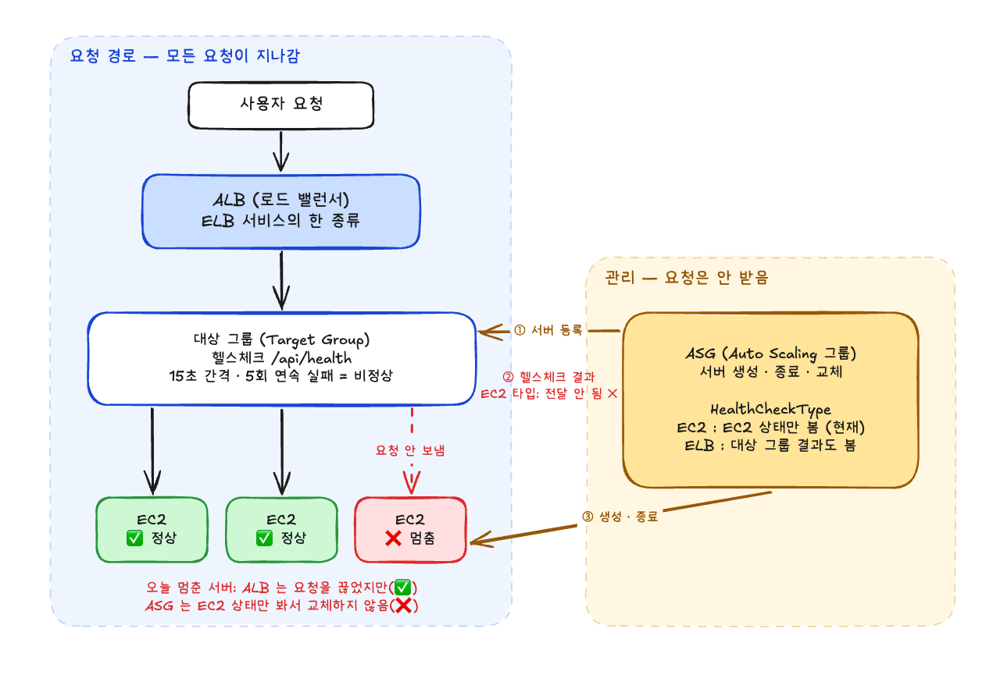
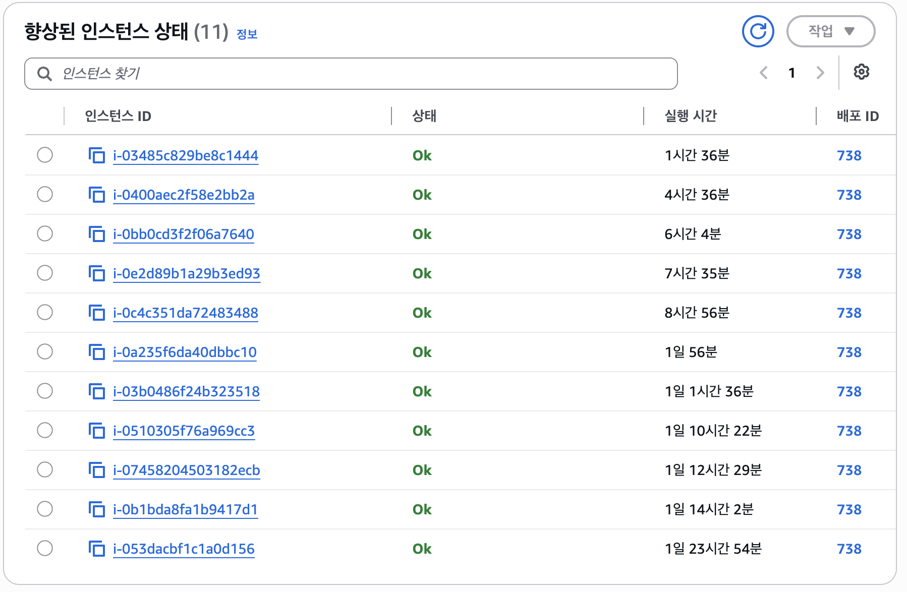
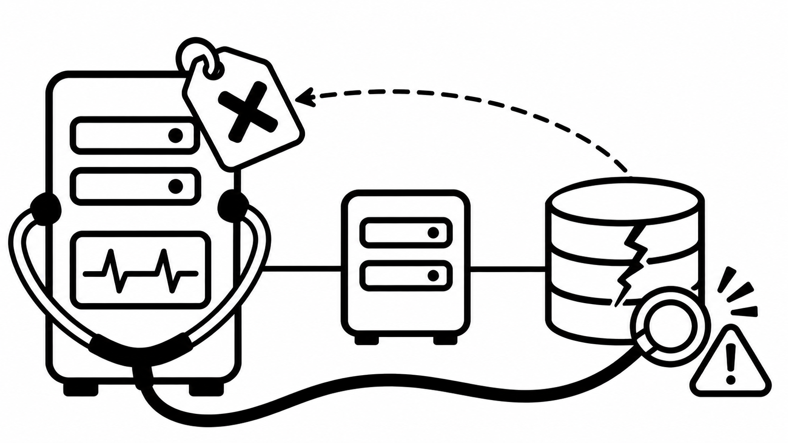
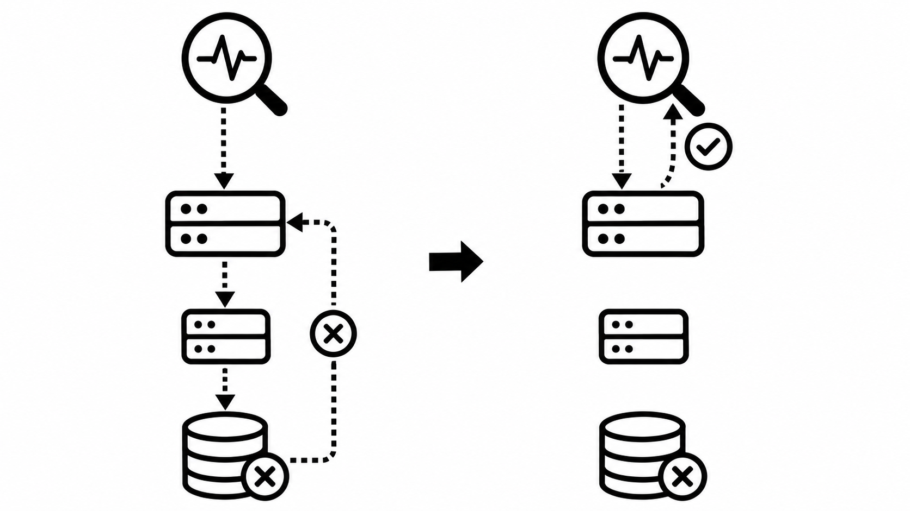
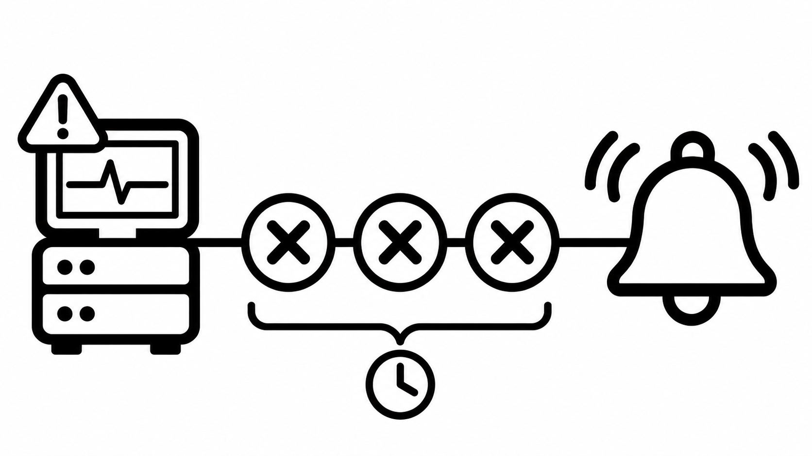
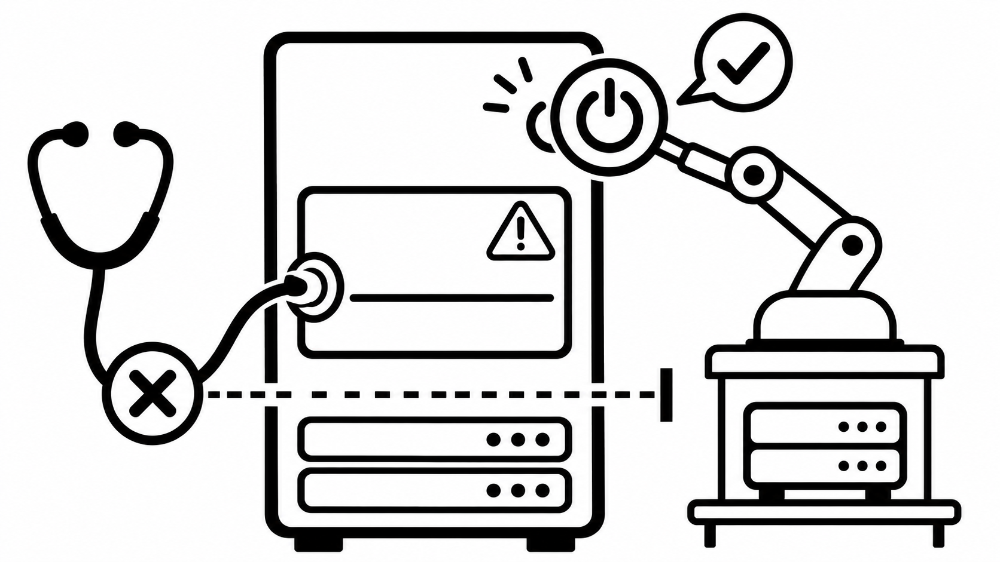
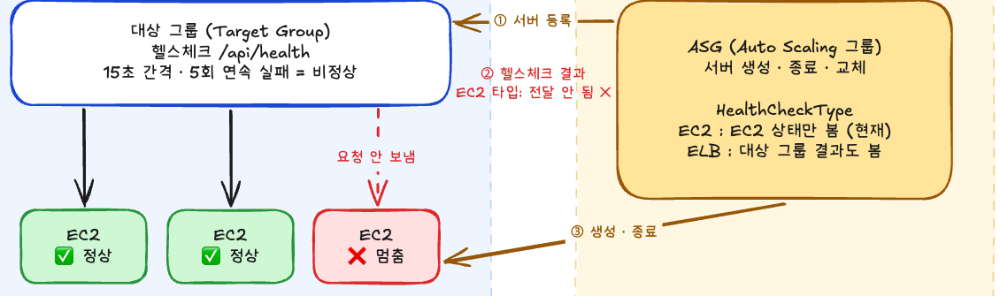
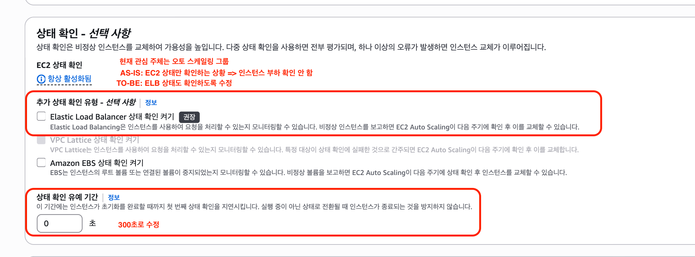
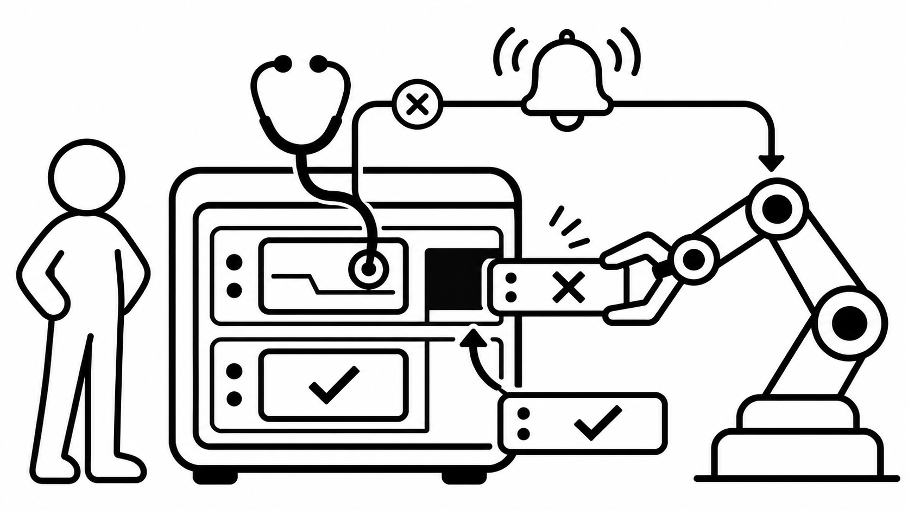

{/* TODO: 출시일로 date 변경 */}

<Callout>아프다는 서버는 멀쩡했고, 멀쩡하다는 서버는 멈춰 있었다.</Callout>

## 들어가며

2주 사이에 헬스체크 관련 작업을 두 번 개선하게 되었다.

첫 번째는 백엔드 장애였는데 프론트 웹 서버까지 비정상으로 판정된 일을 계기로 헬스체크 경로를 바꾼 작업이다. 두 번째는 CPU 과부하로 멈춘 서버가 교체되지 않는 현상을 살펴보다가 헬스체크 타입을 바꾼 작업이다. **첫 번째는 헬스체크가 "무엇을 묻는지"(경로), 두 번째는 그 답을 "누가 듣는지"(타입)의 문제였다.**

| 구분    | 겪은 일                                                     | 원인                            | 조치                                   |
| ------- | ----------------------------------------------------------- | ------------------------------- | -------------------------------------- |
| 첫 번째 | 백엔드 장애인데 프론트 웹 서버 6대가 고장으로 보였다        | 헬스체크 경로가 `/`(홈 SSR)였다 | 경로를 `/api/health`로 변경, 경보 추가 |
| 두 번째 | CPU 100%로 멈춘 프론트 서버 5대가 교체되지 않고 남아 있었다 | ASG 헬스체크 타입이 `EC2`였다   | 헬스체크 타입을 `ELB`로 변경           |

해당 과정에서 살펴보고 알게 된 내용을 정리하고자 한다.

## 헬스체크는 왜 할까

서버 여러 대를 로드 밸런서 뒤에 두면, 그중 한 대가 멈춰도 요청은 계속 그 서버로 들어간다. 사용자 입장에서는 "가끔 안 열리는 사이트"가 된다.

**헬스체크는 고장 난 서버를 사람보다 먼저 찾아내 트래픽에서 빼고, 필요하면 새 서버로 바꾸기 위해 존재한다.** 로드 밸런서가 서버마다 정해진 경로를 주기적으로 호출하고, 타임아웃 안에 정상 응답이 오지 않는 일이 연속되면 그 서버를 Unhealthy로 판정한다.

이번 작업에서 중요했던 건 "건강하다"를 판단하는 주체가 하나가 아니라는 점이다. 우리 프론트 서버는 Elastic Beanstalk(EB) 위에서 돌고 있고, 여기서는 세 주체가 각자 다른 일을 한다.



요청은 ALB와 대상 그룹을 거쳐 서버로 간다. ASG는 요청을 받지 않고, 바깥에서 서버를 등록하고 생성·종료하는 관리 역할만 한다. 위 그림은 두 번째 문제를 살펴보며 그린 구조도로, 멈춘 서버에 ALB는 요청을 끊었지만 ASG는 교체하지 않은 상황을 나타낸다.

| 주체                       | 무엇을 보나                                 | 결과로 하는 일                          |
| -------------------------- | ------------------------------------------- | --------------------------------------- |
| **ALB 대상 그룹**          | 헬스체크 경로가 정상 응답하는지             | Unhealthy 서버에 트래픽을 보내지 않음   |
| **Auto Scaling 그룹(ASG)** | 헬스체크 타입에 따라 EC2 상태 또는 ALB 판정 | Unhealthy 인스턴스를 종료하고 새로 띄움 |
| **EB 상태 보고**           | 요청 지표, 리소스 사용량 등을 종합          | Ok / Warning / Severe 같은 상태 표시    |



EB 콘솔의 `향상된 인스턴스 상태`에서는 인스턴스마다 Ok, Warning, Severe 같은 상태가 표시된다. 하지만 이 화면은 상태를 보여 줄 뿐 교체를 일으키지 않는다.

ALB는 트래픽만 뺀다. 서버를 교체하는 건 ASG다. 처음에는 이 셋을 하나로 생각하고 있었고, 두 문제를 풀면서 하나씩 구분하게 됐다.

## 첫 번째 문제: 백엔드 장애인데 프론트가 아팠다

백엔드 DB 이슈로 API가 잠시 응답하지 못한 일이 있었다. 원인은 백엔드 쪽에서 금방 정리됐다.

그런데 같은 시각 **프론트 웹 서버 6대까지 비정상으로 판정**돼 있었다. 프론트 서버는 배포도, 코드 변경도 없었다. "프론트는 아무 일도 안 했는데 왜 같이 아픈 걸로 보일까?" 이 의문에서 헬스체크 설정을 열어 봤다.

### 헬스체크가 홈 화면을 그리고 있었다



헬스체크 경로가 `/`였다. **헬스체크를 할 때마다 홈 화면을 실제로 SSR로 만들고 있었다.**

| 순서 | 일어난 일                                     |
| ---- | --------------------------------------------- |
| 1    | ALB가 프론트 서버에 `GET /` 헬스체크 요청     |
| 2    | Next.js가 홈 화면을 SSR 하려고 API를 호출     |
| 3    | API가 DB 이슈로 응답하지 못함                 |
| 4    | SSR이 타임아웃 안에 끝나지 않아 헬스체크 실패 |
| 5    | 멀쩡한 프론트 서버 6대가 전부 Unhealthy       |

결국 프론트 서버의 비정상 판정이 "클라이언트 서버가 고장 났다"와 "API가 느리다"를 섞어서 말하고 있었다. 신호가 울려도 어디를 봐야 할지 바로 알 수 없는 상태였다.

### 헬스체크 전용 경로 `/api/health`



헬스체크가 묻는 질문을 "홈 화면을 그릴 수 있나?"에서 "Node 프로세스가 살아서 응답하나?"로 바꿨다. 외부 의존성을 부르지 않고 바로 200을 돌려주는 전용 경로를 추가하고, EB 환경 설정에서 헬스체크 경로를 바꿨다.

```ts
// 예시: 외부 의존성을 호출하지 않고 바로 응답한다
export default function handler(_req, res) {
  res.status(200).json({ status: "ok" });
}
```

- **AS-IS**: `/` → API·DB가 느려도 프론트 서버가 Unhealthy
- **TO-BE**: `/api/health` → **프론트 서버(Node)가 진짜 멈췄을 때만 Unhealthy**

### 헬스체크 경보 구성하기



헬스체크 관련 경보도 살펴봤는데 헬스체크 실패 자체를 알려 주는 경보가 없었다. 그래서 ALB 기본 지표로 경보를 추가했다. 기본 지표라 추가 비용도 없다.

| 항목          | 설정                                                               |
| ------------- | ------------------------------------------------------------------ |
| 지표          | 대상 그룹의 `UnHealthyHostCount` (최대), `HealthyHostCount` (최소) |
| 기간 / 조건   | 1분, `UnHealthyHostCount > 0`                                      |
| 데이터 포인트 | 3분 연속, 누락 데이터는 양호로 처리                                |

3분 연속 조건을 둔 덕분에 배포·증설 때 새 서버가 잠깐 Unhealthy로 잡히는 건 울리지 않는다.

## 두 번째 문제: 멈춘 서버가 교체되지 않았다



특정 페이지를 SSR 하는 과정에서 무거운 연산이 CPU를 100% 점유했다. Node는 싱글 스레드라 이벤트 루프가 막히면 `/api/health`에도 응답하지 못한다.

그리고 첫 번째 작업에서 추가한 **비정상 인스턴스 경보가 정확히 울렸다.** 경로를 바꾼 덕분에 이번 경보는 "프론트 서버 자체가 멈췄다"는 뜻으로 바로 읽혔다.

원인 코드는 팀에서 빠르게 찾아 수정했다. 하지만 이번에 의아했던 지점은 따로 있었다. EB 콘솔에서 해당 인스턴스들이 Severe로 표시되는데도 **멈춘 서버 5대가 종료·교체되지 않고 계속 남아 있었다.** 최대 12대 중 7대만 일하는 상태가 되면서 증설 여유도 사라졌다.

예전에도 경보가 울린 뒤 망가진 인스턴스를 사람이 수동으로 종료한 적이 몇 번 있었다. 그때는 서버를 끄고 나면 해결된 것으로 여겼고, 왜 사람이 직접 꺼야 했는지는 깊게 고민하지 않고 가볍게 넘어갔다.

하지만 다시 곰곰이 생각해보니 사람이 직접 종료해야 하는 흐름이 상당히 어색하게 느껴졌다.

헬스체크가 있는데 왜 ASG가 서버를 교체하지 않는 걸까?

### ASG가 ALB의 말을 듣지 않았다



대상 그룹은 멈춘 서버를 비정상으로 판정해 요청을 끊었지만, 그 결과가 ASG로 전달되지 않았다. 그래서 ASG는 멈춘 서버를 종료·교체하지 않았다. 문제는 **서버를 교체하는 주체인 ASG**였다.

**HealthCheckType은 "ASG가 누구 말을 듣느냐"를 정하는 설정이다.**

| 타입           | ASG가 보는 것                                    | 앱이 멈춘 서버         |
| -------------- | ------------------------------------------------ | ---------------------- |
| **EC2** (기존) | EC2 서버 자체가 켜져 있는지만 본다               | 정상으로 보고 방치     |
| **ELB**        | EC2 상태에 더해 로드 밸런서 헬스체크 결과도 본다 | 종료 후 새 서버로 교체 |

CPU 100%로 앱이 멈춰도 EC2 인스턴스 자체는 켜져 있다. 그래서 EC2 기준으로는 "정상"이었고, ALB가 아무리 Unhealthy라고 해도 ASG는 무시했다.

### 헬스체크 타입을 ELB로



EC2 콘솔 → Auto Scaling 그룹 → 상태 확인에서 두 가지를 바꿨다.

- **Elastic Load Balancer 상태 확인 켜기**: 헬스체크 타입 `EC2` → `ELB`
- **상태 확인 유예 기간**: `0초` → `300초`

유예 기간은 새로 뜬 인스턴스가 앱을 띄우는 동안 헬스체크 실패를 무시해 주는 시간이다. 0초로 두면 부팅 중인 서버가 Unhealthy로 잡혀 바로 종료될 수 있다.

**헬스체크 타입 변경으로 사람 없이 회복하게 만드는 안전망이 생겼다.**

## 마치며



두 문제 모두 처음 보면 "서버가 이상하다"였지만, 실제로는 헬스체크 설정이 무엇을 묻고 누가 듣는지의 문제였다.

- **경로**: 헬스체크가 홈 화면을 그리면 API 장애까지 프론트 장애로 보인다. 자기 서버의 상태만 묻도록 `/api/health`로 바꿨다.
- **경보**: 헬스체크 실패를 알려 주는 경보가 없었다. `UnHealthyHostCount` 경보를 추가했고, 두 번째 문제에서 그 경보가 실제로 장애를 잡았다.
- **타입**: ALB가 Unhealthy로 판정해도 ASG가 EC2 타입이면 서버를 교체하지 않는다. ELB 타입으로 바꿔 멈춘 서버가 자동으로 교체되게 했다.

**이제 헬스체크는 정말 멈춘 서버만 골라내고, 골라낸 서버는 사람 대신 ASG가 교체한다.**

## 참고 문서

- [AWS - Target group health checks for your Application Load Balancers](https://docs.aws.amazon.com/elasticloadbalancing/latest/application/target-group-health-checks.html)
- [AWS - Health checks for instances in an Auto Scaling group](https://docs.aws.amazon.com/autoscaling/ec2/userguide/ec2-auto-scaling-health-checks.html)
- [AWS - Set the health check grace period for an Auto Scaling group](https://docs.aws.amazon.com/autoscaling/ec2/userguide/health-check-grace-period.html)
