<Callout>새 HTML이 어제의 서버에게 오늘의 JS를 달라고 했다</Callout>

## 들어가며 — 다들 어렴풋이 겪었지만 넘어가던 에러

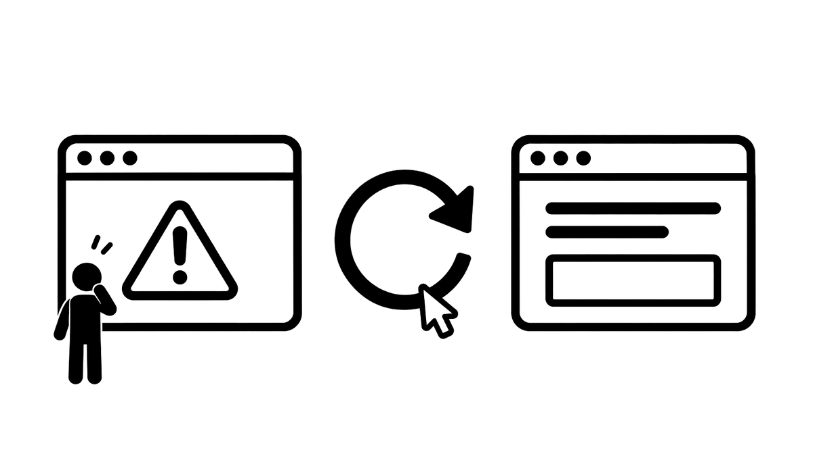

배포할 때 어쩌다 "알 수 없는 오류가 발생했습니다" 페이지가 뜨고 새로고침하면 멀쩡해진다. 팀 안에서도 몇 번 이야기가 나왔던 현상이지만 간혹 발생하는 느낌이고 새로고침하면 바로 괜찮아지다 보니 "배포 때 어쩌다 잠시 발생하는 것"으로 암묵적으로 넘어가곤 했다.

해당 이슈를 다시 살펴보게 된 계기는 프론트 인스턴스 이상 경보였다. 경보 원인을 찾으려고 배포 구간의 사용자 요청 로그(nginx access.log)를 살펴봤다.

문제를 크게 느낀 건 숫자를 본 순간이었다. 평소 분당 40 ~ 100건이던 4xx 응답이, 옛 빌드와 새 빌드가 함께 응답한 2분(14:14~14:15) 동안 **441건, 428건**으로 치솟았다. 같은 구간 전체 요청 중 4xx 비율도 평소 약 1.3%에서 약 **9.9%** 로 올랐다. "드물게"라고 여겼던 에러는 사실 훨씬 많은 사용자가 배포할 때마다 겪고 있었던 것이다.

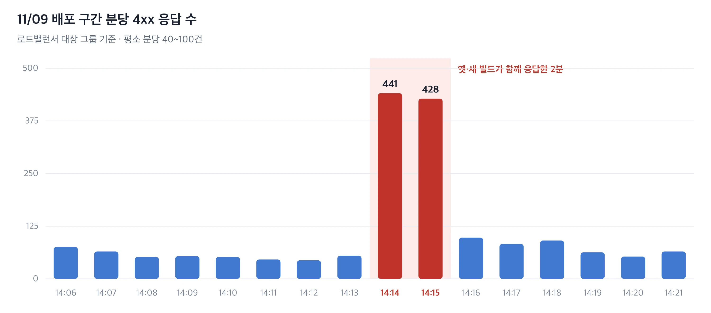

문제의 심각성을 확인한 뒤 분석 내용을 팀에 공유했고, 배포 중 생기는 404를 줄이는 작업을 진행하게 되었다. 해당 글에서 원인 및 해결 구조, 적용하면서 만난 인프라 작업 과정을 정리하고자 한다.

## 왜 배포 중에만 파일이 없어질까

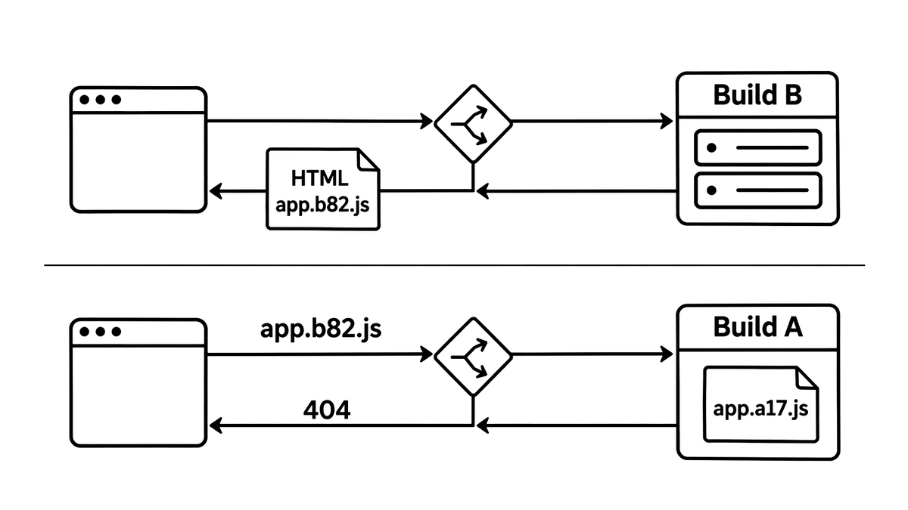

서비스 환경은 Next.js 앱을 Elastic Beanstalk(ALB + nginx)로 배포하고, 앞단에 CloudFront를 두는 구성이다.

배포 구간의 404는 JS 청크와 서비스 워커 파일에 몰려 있었다. 서버가 고장 난 게 아니라 **배포 방식에서 생기는 현상**이었다.

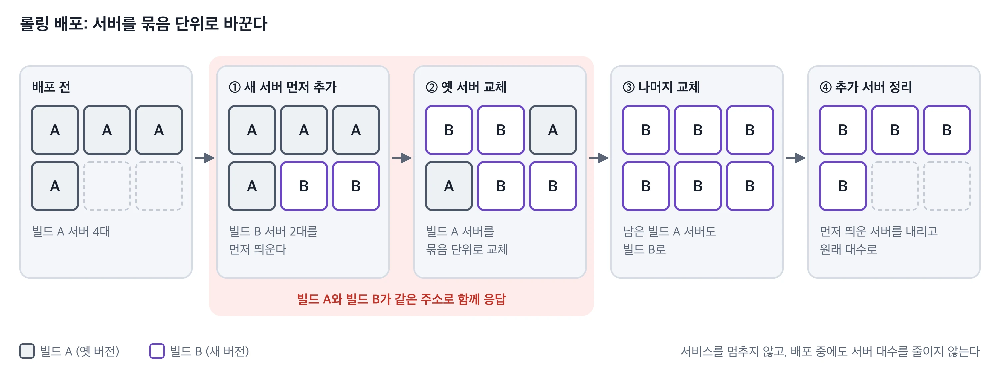

롤링 배포는 **서버를 한꺼번에 바꾸지 않고 묶음 단위로 교체하는 방식**이다. 서비스를 멈추지 않고 배포할 수 있다. 우리가 쓰는 `RollingWithAdditionalBatch`는 새 서버를 먼저 띄운 뒤 옛 서버를 내린다. 배포 중에도 용량은 유지된다. 하지만 잠깐 동안 두 빌드가 같은 주소로 응답하는 경우가 생기게 된다.

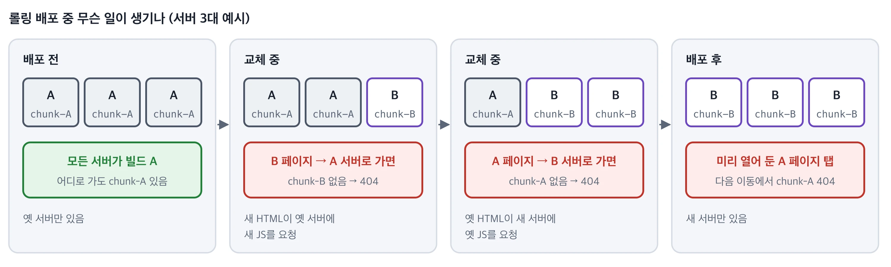

Next.js는 빌드마다 정적 파일 이름(해시)이 바뀌고, 각 서버는 자기 빌드 파일만 가지고 있다. 로드밸런서는 HTML 요청과 JS 요청을 따로 나눠 보내므로, 두 빌드가 섞인 구간에는 HTML을 준 서버와 JS를 받으러 간 서버가 엇갈릴 수 있다.

앞서 치솟았던 2분이 바로 이 엇갈림이다.

## 선택지 비교

| 방식                                 | static · worker 404     | 대가                                                              |
| ------------------------------------ | ----------------------- | ----------------------------------------------------------------- |
| 블루/그린 배포                       | 섞이는 구간 자체가 없음 | 인프라 변경이 큼, 배포 중 용량 2배                                |
| ALB 고정 세션                        | 대부분 해소             | 쿠키 전달 설정, 서버별 부하 쏠림                                  |
| S3 + `assetPrefix`                   | `/_next/static`만 해소  | 앱 코드 변경, 다른 도메인 CORS, `public/`의 worker에는 적용 안 됨 |
| **S3 + CloudFront 원본 그룹 (선택)** | **해소**                | CloudFront·S3 설정만, 앱 코드 변경 없음                           |

CloudFront 원본 그룹을 고른 이유는 세 가지다. 앱 코드와 배포 방식을 그대로 둘 수 있고, S3에 파일이 없어도 기존 서버가 대신 응답하며, 문제가 생기면 CloudFront 동작 하나만 원래대로 돌리면 된다.

## 해결 구조 — S3에 먼저 묻고, 없으면 서버로

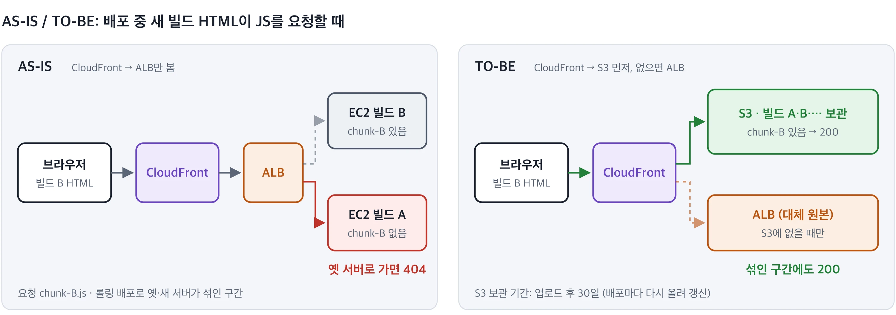

빌드할 때마다 정적 파일을 `aws s3 cp`로 S3에 올린다. `sync --delete`가 아니라 덮어쓰기만 하므로 옛 빌드 파일이 지워지지 않고 남는다. 그래서 두 빌드가 섞인 구간에도 S3에는 두 빌드의 파일이 모두 있다.

이를 위해 빌드 설정(buildspec)에 S3로 올리는 명령어를 추가했다.

```bash
CACHE="public,max-age=31536000,immutable"

# Next.js 빌드 결과물: 브라우저 주소 /_next/static/* 와 같은 경로로 올린다
aws s3 cp .next/static "s3://example-cdn/client-static/_next/static" \
  --recursive --cache-control "$CACHE"

# public/ 의 서비스 워커 파일만 골라서 올린다
aws s3 cp public "s3://example-cdn/client-static" \
  --recursive --exclude "*" --include "worker-*.js" --cache-control "$CACHE"
```

S3 키를 브라우저 주소와 같은 경로로 맞춰 두었기 때문에, CloudFront는 원본 경로(`/client-static`)만 앞에 붙여 찾으면 된다. 파일 이름에 해시가 들어 있어 내용이 바뀌면 이름도 바뀌므로 `immutable`로 오래 캐시해도 된다.

순서도 중요하다. 빌드 → S3 업로드 → 승인 → 롤링 배포 순서라서 새 서버가 뜨기 전에 새 파일이 이미 S3에 올라가 있다. 올라간 파일은 S3 수명 주기로 지운다.

실제로 배포 후 S3를 열어 보면, 브라우저 주소와 같은 구조로 `_next/` 폴더와 서비스 워커 파일이 올라가 있다.

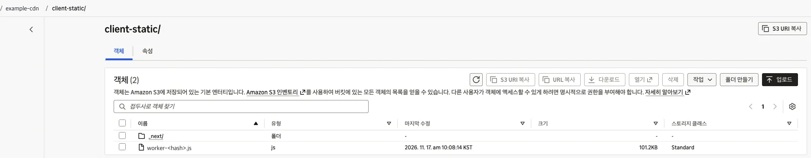

수명 주기 규칙은 버킷 전체가 아니라 `client-static/` 접두사에만 걸고, 객체 생성 후 30일이 지나면 만료되게 했다.

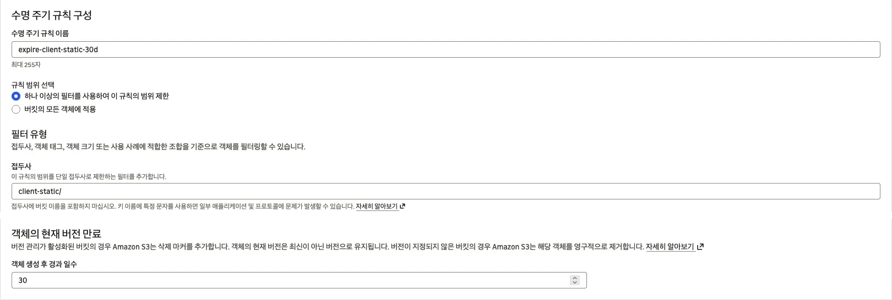

### 원본 그룹 동작 방식

CloudFront에서 원본 그룹을 만들고, 1순위에 S3 원본을, 2순위에 기존 서버(ALB)를 가리키는 대체 원본을 넣었다. 장애 조치 기준은 403과 404만 골랐다.

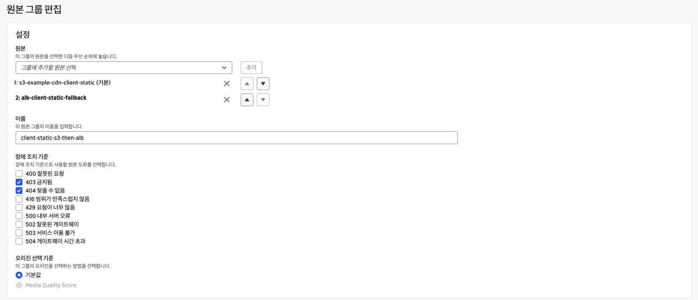

이렇게 구성하면 요청마다 다음처럼 동작한다.

| 상황           | CloudFront 동작                            | 사용자가 받는 응답         |
| -------------- | ------------------------------------------ | -------------------------- |
| S3에 파일 있음 | S3 응답 전달                               | 200 · `server: AmazonS3`   |
| S3에 파일 없음 | S3가 403·404를 주면 같은 요청을 즉시 ALB로 | ALB 응답 · `server: nginx` |
| 둘 다 없음     | ALB의 404 전달                             | 404 (지금과 같음)          |

재요청은 CloudFront 안에서 일어나므로 사용자는 응답을 한 번만 받는다. "ALB로 바뀐 상태"가 남지 않아서 다음 요청도 S3부터 시도한다.

S3는 버킷 목록 권한이 없으면 없는 파일에 403을 준다.

## 구성하면서 만난 함정

### Host 헤더: S3와 ALB가 서로 다른 이름을 원한다

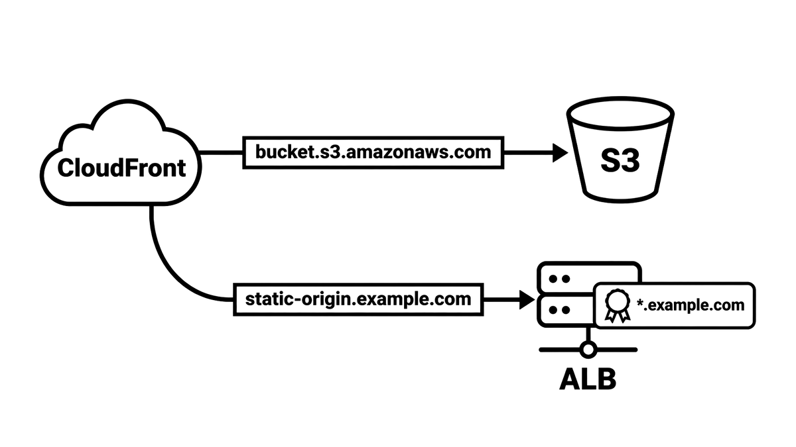

테스트 서버에서 전환해 보니 S3 응답은 정상이었다. 그런데 S3에 없는 파일이 ALB로 넘어가지 않고 502가 났다. S3에 있는 파일은 잘 나가니 화면은 멀쩡했다. 안전장치만 조용히 고장 난 상태였다.

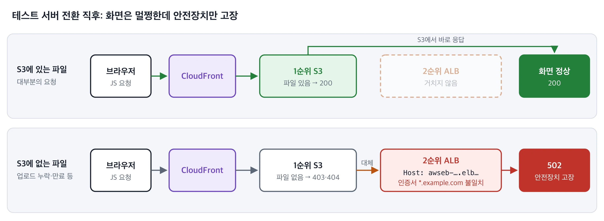

원인은 `Host 헤더`였다.

1. Host 헤더는 "어느 이름으로 불렀는지"다. 브라우저 → CloudFront 구간은 주소창 도메인이지만, CloudFront → 원본 구간은 CloudFront가 다시 정한다. HTTPS 연결 때 알리는 이름(SNI)도 같은 값을 쓴다.
2. 기존 동작에 붙어 있던 `AllViewer` 원본 요청 정책은 브라우저가 보낸 `Host: example.com`을 원본까지 그대로 넘긴다. ALB는 원래 이 값으로 받아 왔으니 괜찮지만, S3는 Host로 버킷을 찾기 때문에 `example.com`이라는 버킷을 찾다 실패한다. 그래서 정적 파일 동작에서는 이 정책을 뺐다.
3. 정책을 빼면 각 원본의 도메인이 그대로 Host가 된다. S3는 버킷 주소라 정상이지만, ALB는 `awseb-….elb.amazonaws.com` 주소로 불리게 되고 ALB 인증서(`*.example.com`)와 이름이 맞지 않아 502가 난다.
4. 해결은 ALB를 인증서 안의 이름으로 부르는 것이다. Route 53에 같은 ALB를 가리키는 별칭 `static-origin.example.com`을 만들어 대체 원본의 도메인으로 쓰고, ALB 리스너 규칙의 Host 목록에도 이 이름을 추가했다.

| CloudFront 설정                | CloudFront → S3                      | CloudFront → ALB (대체)                  |
| ------------------------------ | ------------------------------------ | ---------------------------------------- |
| AllViewer (기존)               | `Host: example.com` → 버킷을 못 찾음 | `Host: example.com` → 인증서 일치        |
| 정책 없음 + ALB 기본 주소      | 버킷 주소 → 정상                     | `Host: awseb-….elb.amazonaws.com` → 502  |
| **정책 없음 + 대체 전용 별칭** | 버킷 주소 → 정상                     | `Host: static-origin.example.com` → 정상 |

실제 작업은 AWS 콘솔에서 세 군데를 고치는 일이었다.

#### ① Route 53에 대체 전용 별칭 만들기

같은 ALB를 가리키는 A 레코드(별칭)를 앱마다 하나씩 만들었다. 인증서(`*.example.com`) 안에 들어가는 이름이라 HTTPS 연결이 통과한다.

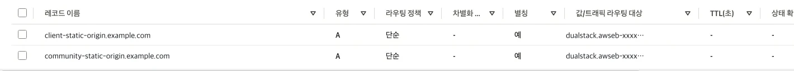

#### ② ALB 리스너 규칙의 Host 목록에 별칭 추가

ALB 리스너 규칙은 Host와 원본 인증 헤더를 함께 검사하고, 어느 규칙에도 맞지 않으면 기본 동작(301 리디렉션)으로 보낸다. Host 목록에 별칭을 넣어야 대체 요청이 기본 동작으로 빠지지 않는다.

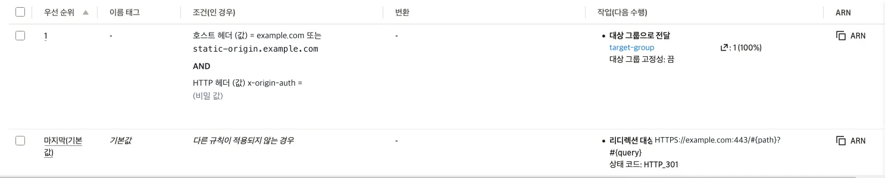

별칭을 만든 뒤에는 curl로 먼저 확인했다. 원본 인증 헤더 없이 부르면 규칙에 걸리지 않고 기본 동작으로 떨어지는데, 301이 돌아왔다는 건 인증서 단계는 통과했다는 뜻이다.

```bash
$ curl -sI https://static-origin.example.com/
HTTP/2 301
server: awselb/2.0
location: https://example.com:443/
```

#### ③ 대체 원본을 별칭으로 만들기

CloudFront 대체 원본의 오리진 도메인에 별칭을 직접 입력하고, HTTPS만 쓰도록 했다.

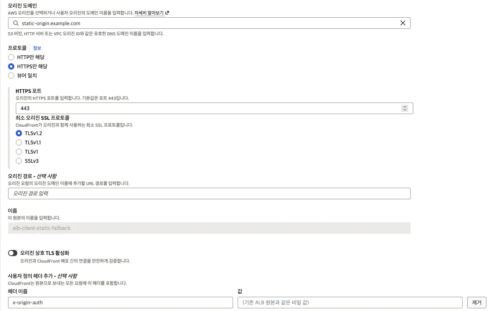

### 원본 그룹은 GET/HEAD만 받는다

원본 그룹을 쓰는 동작은 허용 메서드를 GET/HEAD(+OPTIONS)로만 둘 수 있다. 그래서 기존 동작을 통째로 바꾸지 않고, 정적 파일 경로만 동작으로 따로 떼어 원본 그룹에 연결했다. `/worker-*.js`는 기본 동작으로 가던 경로라 동작을 새로 추가했다.

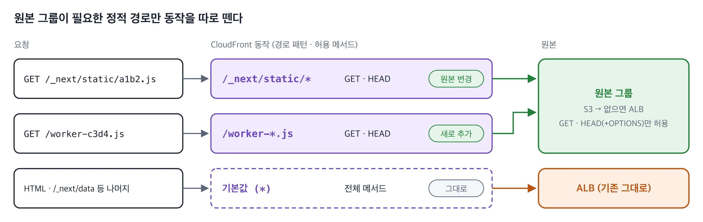

정적 파일 동작에서 바뀐 건 세 가지다. 원본이 ALB에서 원본 그룹으로, 허용 메서드가 전체에서 GET·HEAD로, 원본 요청 정책이 `AllViewer`에서 없음으로 바뀌었다.

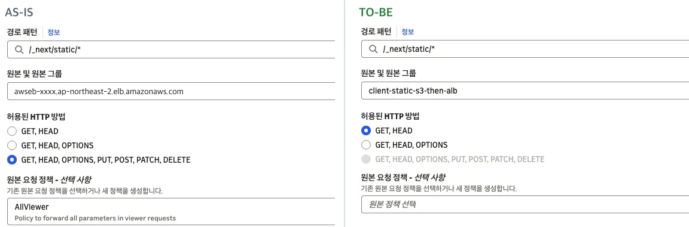

### 경로마다 읽을 수 있는 CloudFront는 하나씩

S3 버킷은 OAC(Origin Access Control)로 CloudFront만 읽을 수 있게 했다. 한 버킷에 두 앱의 파일이 있어서, 경로마다 읽을 수 있는 CloudFront 배포를 하나씩만 허용했다. `client-static/*`은 Client 배포만, `community-static/*`은 커뮤니티 배포만 읽는다.

CloudFront에서 S3 원본을 만들 때 원본 경로를 `/client-static`으로 두고, 원본 액세스는 OAC를 고른다.

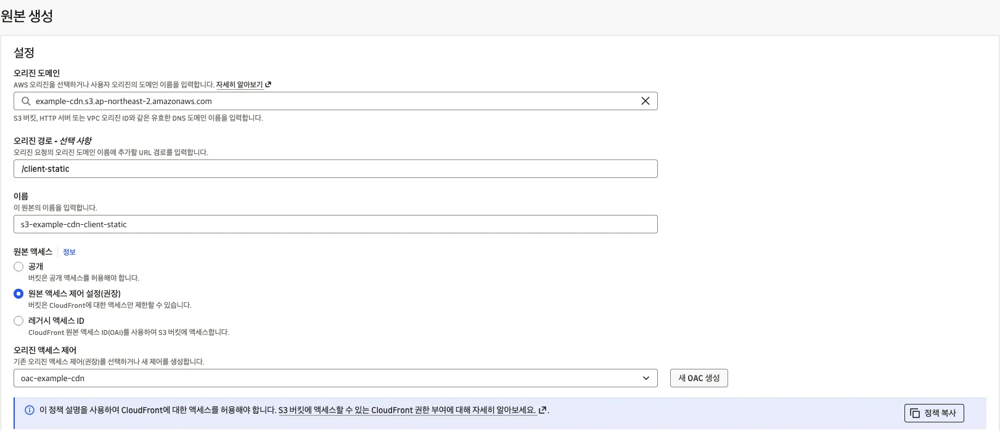

버킷 정책에서는 경로마다 읽을 수 있는 배포를 `AWS:SourceArn` 조건으로 하나씩 지정한다.

```json
{
  "Version": "2012-10-17",
  "Statement": [
    {
      "Sid": "AllowClientCloudFrontReadStatic",
      "Effect": "Allow",
      "Principal": { "Service": "cloudfront.amazonaws.com" },
      "Action": "s3:GetObject",
      "Resource": "arn:aws:s3:::example-cdn/client-static/*",
      "Condition": {
        "StringEquals": {
          "AWS:SourceArn": "arn:aws:cloudfront::<ACCOUNT_ID>:distribution/<CLIENT_DISTRIBUTION_ID>"
        }
      }
    },
    {
      "Sid": "AllowCommunityCloudFrontReadStatic",
      "Effect": "Allow",
      "Principal": { "Service": "cloudfront.amazonaws.com" },
      "Action": "s3:GetObject",
      "Resource": "arn:aws:s3:::example-cdn/community-static/*",
      "Condition": {
        "StringEquals": {
          "AWS:SourceArn": "arn:aws:cloudfront::<ACCOUNT_ID>:distribution/<COMMUNITY_DISTRIBUTION_ID>"
        }
      }
    }
  ]
}
```

## 무중단으로 반영한 순서

| 순서 | 작업                                           | 사용자 영향       |
| ---- | ---------------------------------------------- | ----------------- |
| 1    | 빌드에 S3 업로드 추가 → 배포 후 업로드 확인    | 없음              |
| 2    | S3 원본 · OAC · 버킷 정책                      | 없음              |
| 3    | Route 53 대체 전용 별칭 → ALB                  | 없음              |
| 4    | ALB 규칙 Host 목록에 별칭 추가                 | 없음              |
| 5    | 대체 원본(인증 헤더 복사) · 원본 그룹(403·404) | 없음              |
| 6    | **정적 경로 동작을 원본 그룹으로 전환**        | **이때부터 반영** |
| 7    | 응답 헤더 · 대체 404 · CORS 확인               | —                 |
| 8    | 수명 주기 30일 (경로 2개만, 버킷 전체 금지)    | 없음              |

핵심은 대체 경로(3~5)를 먼저 갖춘 뒤에 전환(6)한 것이다.

사용자 응답이 바뀌는 단계는 6 하나뿐이라 되돌리기도 간단하다. 6의 동작만 원래 값(기존 ALB 원본, 전체 메서드, `AllViewer`)으로 돌리고 `/worker-*.js` 동작을 지우면, 재배포 없이 몇 분 안에 원래대로 돌아간다.

## 결과

최종적으로 정적 파일 경로만 S3 원본 그룹으로 나가고, 나머지 요청과 배포 방식은 그대로인 구조가 됐다.

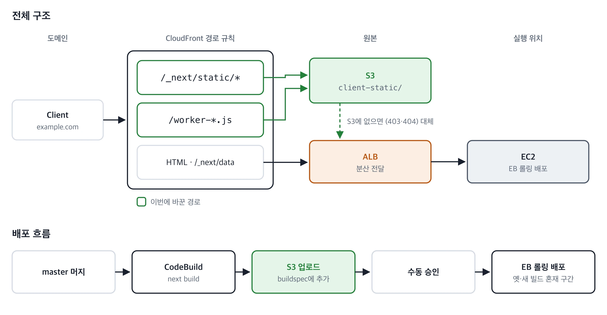

배포 시작부터 배포가 끝나고 10분 뒤까지의 nginx 로그에서 정적 파일 404만 따로 셌다. 전환 전 배포(11/09)와 전환 후 첫 배포(11/17)를 나란히 놓으면 다음과 같다.

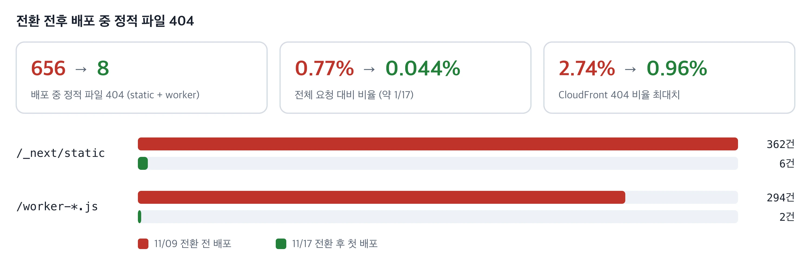

## 마치며

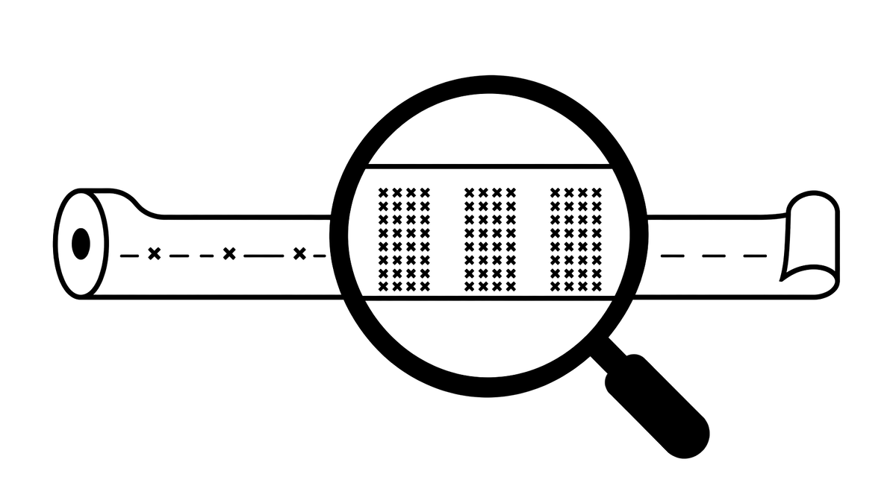

"가끔 나는 에러"라는 말은 문제의 크기를 가린다. 새로고침하면 사라지니 누구도 급하다고 느끼지 않았고, 그사이 배포할 때마다 같은 패턴이 반복되고 있었다.

로그를 세어 숫자로 바꾸고 나서야 "배포 때 원래 그런 것"이 "**배포마다 수백 건씩 실패하는 요청**"으로 보였다. **익숙해서 넘기던 불편함일수록 수치화해서 접근**해 보는 게 필요하다는 것을 느꼈다.

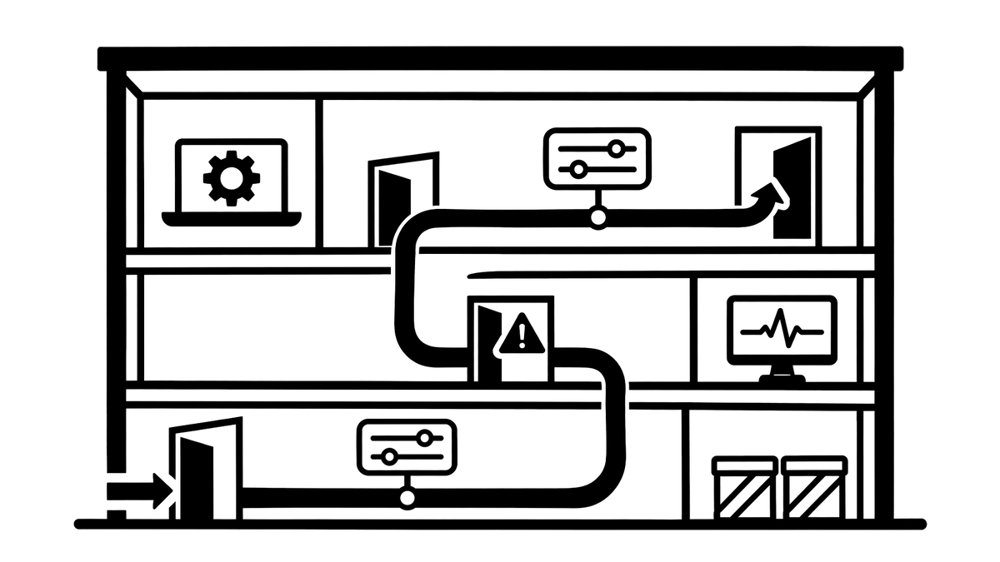

이번 작업으로 전반적인 인프라를 다룰 수 있었다. 빌드 단계, 저장소, CDN, DNS, 로드밸런서, 배포, 관측까지, **요청 하나가 브라우저에서 서버에 닿기까지 지나는 계층을 처음부터 끝까지 따라가 봤다.** 문제는 그중 한 계층에서 보였지만, 원인과 해결은 여러 계층에 걸쳐 있었다.

그 과정에서 가장 크게 배운 건 **계층마다 기대하는 것이 다르다는 점**이었다. 같은 요청인데 각각 다른 이름을 원했고 한 계층에서 문제없던 설정이 다른 계층에서는 장애의 원인이 됐다. 그래서 계층마다 기대하는 것을 이해하고 계층 간 연결을 확인하며 계층별로 문제를 좁혀가는 과정이 필요했다.

화면 뒤에서 요청 하나가 지나는 길을 직접 그려 보고 그 길을 바꿔 보는 일이 인프라 작업의 재미인 것 같다.
