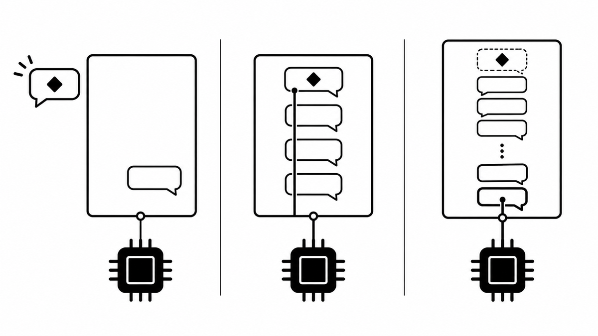
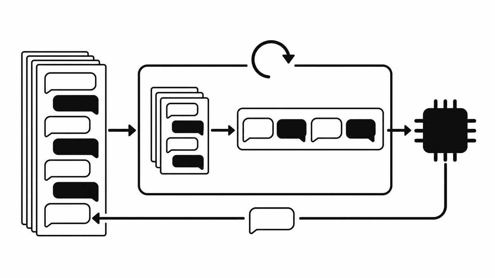
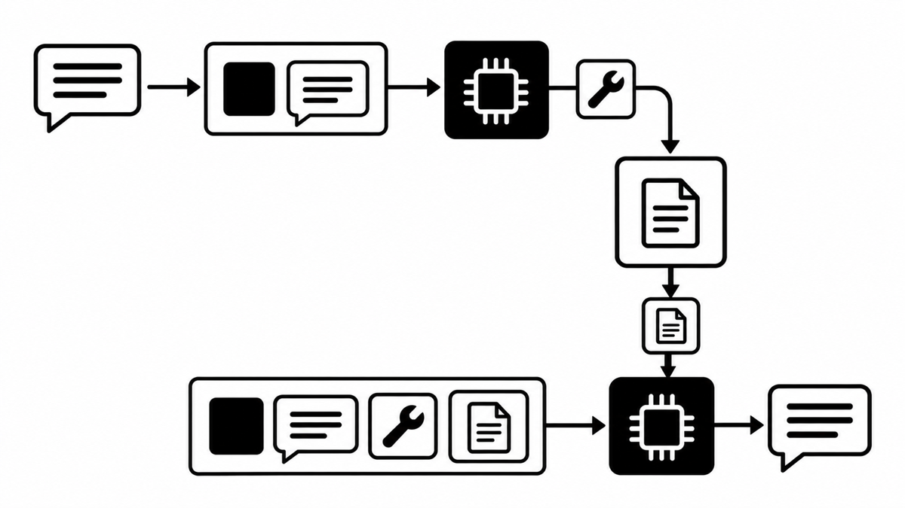
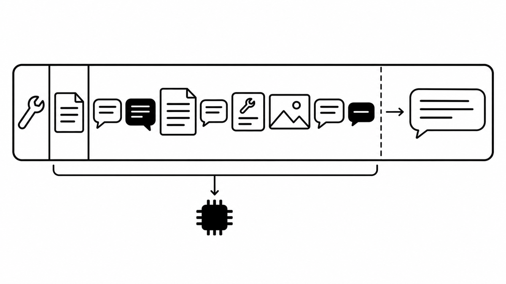
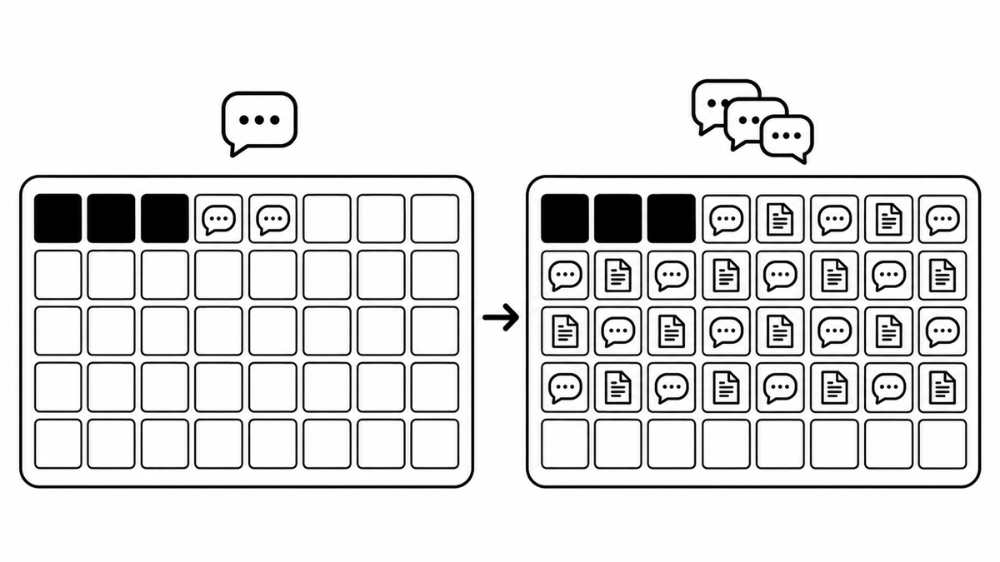
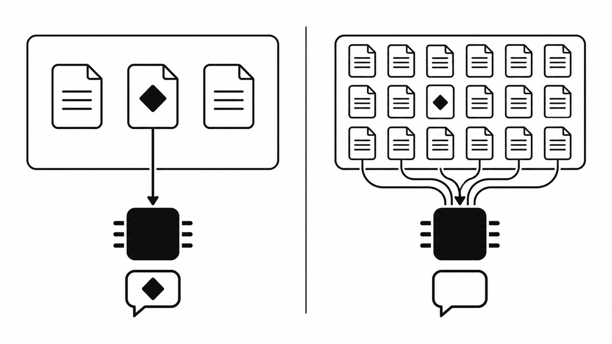
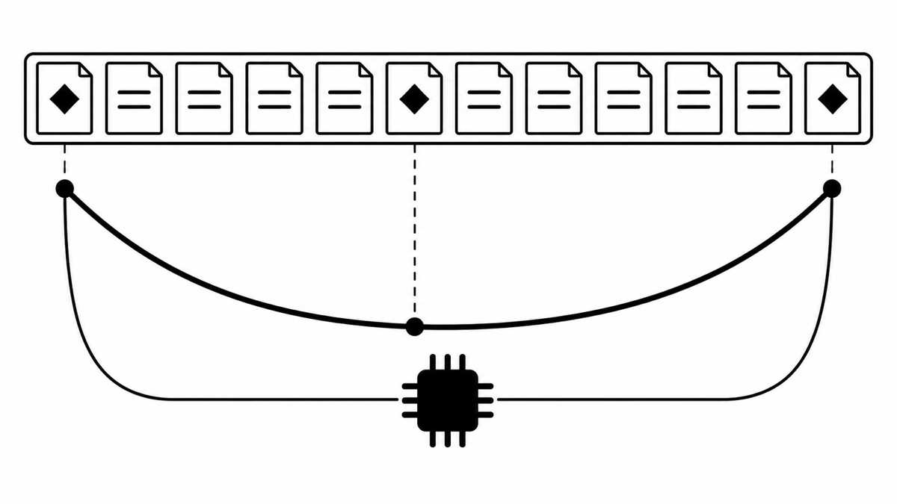
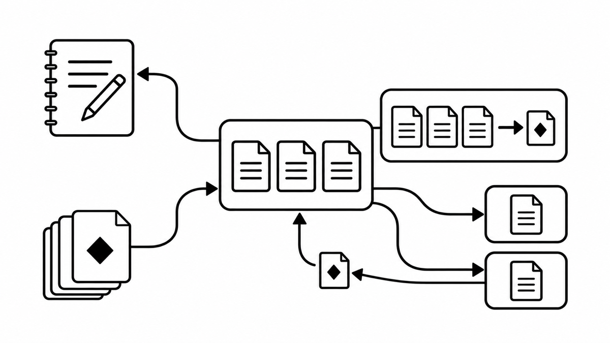
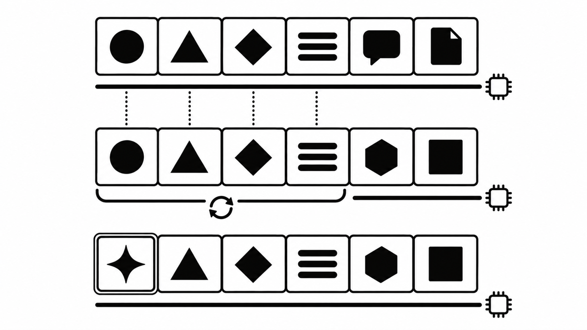
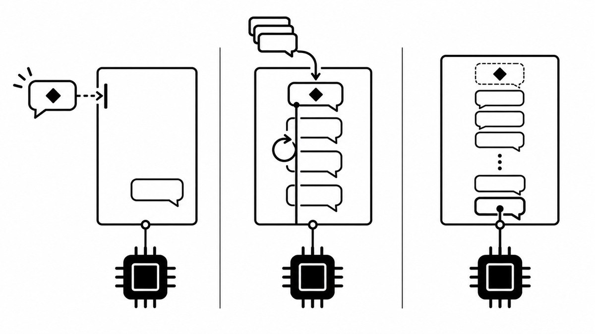

<Callout>
  모델은 아무것도 기억하지 않는다 — 기억은 매번 다시 실리는 것이다
</Callout>

<iframe
  src="/slides/context-engineering.html"
  title="AI는 무엇을 기억하고 무엇을 잊는가 발표 자료"
  loading="lazy"
  allowFullScreen
  style={{
    width: "100%",
    aspectRatio: "16 / 10",
    border: 0,
    borderRadius: "8px",
  }}
/>

<a
  href="/slides/context-engineering.html"
  target="_blank"
  rel="noopener noreferrer"
>
  발표 자료 새 탭에서 보기
</a>

AI로 개발하는 이야기를 하다 보면 컨텍스트 엔지니어링, 하네스 엔지니어링, 요즘은 루프 엔지니어링까지 새로운 키워드가 계속 생겨난다. 그리고 그 키워드들이 빠르게 바뀐다는 느낌을 받았다.

평소 AI를 다룰 때 가장 중요하게 생각하는 키워드는 "맥락"이다. 그래서 이번 스터디 발표를 기회 삼아, 맥락을 다룬다고 느껴졌던 컨텍스트 엔지니어링 지식을 점검해 보기로 했다.

## 들어가며: AI는 정말 기억할까

Claude Code를 쓰다 보면 흔히 만나는 장면부터 보자.

1. 새 세션을 열면 Claude는 어제 나눈 대화를 모른다.
2. 같은 세션에서는 30턴 전에 한 이야기도 기억한다.
3. 그런데 아주 긴 세션에서는 처음에 한 지시를 다시 잊는다.



같은 AI인데 어떤 때는 기억하고 어떤 때는 잊는다. 무엇이 다를까?

인상 깊었던 건, 이 "잊는다"는 표현이 공식 문서에도 그대로 나온다는 점이었다.

> When the context window is getting full, Claude may start "forgetting" earlier instructions or making more mistakes.
>
> — [Claude Code 문서, Best practices](https://code.claude.com/docs/en/best-practices)

"AI가 기억한다"는 게 실제로는 어떤 일인지부터 살펴보자.

## 기억하는 건 모델이 아니라 하네스다

**모델은 요청 사이에 아무것도 저장하지 않는다.** 대화가 이어지는 것처럼 보이는 건 하네스가 매번 지난 대화 전체를 다시 보내기 때문이다.

매 턴의 입력은 지난 대화 기록 전체에 이번 사용자 메시지를 더한 것이고, 모델의 출력은 다음 턴의 입력에 다시 붙는다. 모델 입장에서는 매번 처음 보는 긴 글을 읽고 답하는 셈이다.



### 하네스, 세션, 컨텍스트

여기서 세 가지 이름을 구분해 보자.

- **하네스(harness)**: Claude를 호출하고 도구 호출을 처리하는 루프. Claude Code 같은 프로그램이 여기에 해당한다.
- **세션(session)**: 일어난 모든 일을 쌓아 두는 추가 전용(append-only) 기록.
- **컨텍스트(context)**: 이번 요청 한 번에 모델이 실제로 받는 전부.

> 사실 발표를 준비하기 전까지는 하네스라는 키워드를 들으면 "이건 좀 과한 거 아닌가?" 하는 어렴풋한 생각만 가지고 있었다. 그런데 정의를 따라가 보니 매일 쓰던 Claude Code가 바로 하네스였다. 의식하지 못했을 뿐 하네스는 이미 쓰이고 있었고, 대화가 이어지는 것처럼 보이게 만드는 핵심 기능을 맡고 있었다.

**세션은 컨텍스트 창이 아니다.** 기록에 남아 있어도 이번 요청에 실리지 않으면, 모델에게는 없는 것과 같다.

|               | 세션 (session)                | 컨텍스트 (context)                                        |
| ------------- | ----------------------------- | --------------------------------------------------------- |
| 무엇          | 일어난 모든 일의 기록         | 이번 요청 한 번에 모델에게 보내는 것                      |
| 어디에        | 하네스 쪽 저장소(디스크)      | 요청 안. 모델이 읽고 나면 남지 않는다                     |
| 크기          | 계속 늘어난다. 창 한도와 무관 | context window 한도 안(최신 모델 다수 1M 토큰, 출력 포함) |
| compaction 뒤 | 원래 메시지가 그대로 남는다   | 앞부분이 요약 한 덩어리로 바뀐다                          |
| 모델이 보나   | 직접은 못 본다                | 이것만 본다                                               |

### 메시지는 한 번, 요청은 여러 번

**턴과 요청도 구분해야 한다.**

턴은 내가 메시지를 보내고 최종 답을 받을 때까지이고, 요청은 모델을 한 번 호출하는 단위다. 도구를 한 번 쓸 때마다 요청이 한 번 더 가고, 그때마다 처음부터 전부 다시 보낸다.

"README 요약해줘"라는 메시지를 한 번 보낸 상황을 보자.

```
턴 1 · "README 요약해줘"
요청 1  [tools · system][내 메시지]                          → Read 호출을 출력하고 멈춤
요청 2  [tools · system][내 메시지][Read 호출][README 내용]   → 요약 답변

턴 2 · 다음 메시지
요청 3  [tools · system][내 메시지][Read 호출][README 내용][답변][다음 메시지]
```

모델은 도구를 직접 쓰지 못한다. "Read를 실행해 줘"라고 출력하고 멈출 뿐이다. 하네스가 Read를 실행하고, 그 결과를 붙여 처음부터 다시 보낸다. 메시지는 한 번 보냈지만 요청은 두 번 갔다.

그리고 한 번 읽은 README 내용은 이후 모든 요청에 다시 실린다. 도구 결과가 컨텍스트를 가장 빨리 채우는 이유다.



그렇다면 매번 다시 보내는 그 "전부"에는 정확히 무엇이 들어 있을까?

## 프롬프트 한 줄이 아니라 요청 하나 전부

**모델이 보는 건 내가 친 한 줄이 아니라 요청 하나에 담긴 전부다.**

"프롬프트"라고 하면 보통 입력창에 친 한 줄을 떠올린다. 하지만 컨텍스트 창에는 다음 사항들이 함께 들어간다.

- system prompt
- 모든 메시지: 대화, 도구 결과, 이미지, 문서
- 도구 정의
- 이번 출력: thinking 포함

순서로 보면 tools, system, messages가 차례로 놓이고, 내가 친 한 줄은 messages의 맨 끝에 붙는다. 그 뒤를 이번 출력이 이어서 채운다.

```
[tools][system][messages ··························· 내가 친 한 줄][출력]
 └ 잘 안 바뀐다    └ CLAUDE.md · 메모리 · 대화 · 도구 결과
```



여기서 다음 세 가지를 알아두면 좋다.

- **출력도 같은 공간을 쓴다.** 입력이 창을 거의 채우면 답을 쓰다가 한도에서 멈춘다.
- **캐시된 토큰도 포함된다.** 캐시는 값을 바꿀 뿐, 공간은 그대로 차지한다.
- **최신 모델 다수는 1M 토큰 창이다.** 넓어졌지만, 넓다고 다 쓰는 건 아니다.

### /context로 직접 보기

Claude Code는 내가 입력하기 전부터 이미 많은 것을 싣는다. (CLAUDE.md, auto memory, MCP 서버 지침, 스킬 설명, ...)

그리고 파일을 읽을 때마다 해당 내용이 쌓인다.

`/context` 명령을 실행하면 지금 컨텍스트가 무엇으로 채워져 있는지 직접 볼 수 있다.



모델은 기억하지 않으니 매번 다시 실어야 하고, 실을 수 있는 공간은 유한하다.

**그렇다면 무엇을 실어야 할까?** 이 질문이 바로 컨텍스트 엔지니어링이 다루는 문제다.

## 컨텍스트 엔지니어링은 무엇을 푸는가

지금까지 본 내용을 정리하면 세 가지 제약이 남는다.

| 제약                               | 그래서 생기는 질문                                 |
| ---------------------------------- | -------------------------------------------------- |
| 1. 모델은 기억하지 않는다          | 무엇을 매번 다시 실을까? 무엇을 창 밖에 남겨 둘까? |
| 2. 창은 유한하고, 출력도 같이 쓴다 | 무엇을 빼고, 무엇을 줄일까?                        |
| 3. 길어질수록 흐려진다             | 무엇을 넣지 말아야 할까? 어디에 둘까?              |

**컨텍스트 엔지니어링은 이 세 제약 안에서 "이번 단계에 무엇을 보여줄까"를 정하는 일이다.**

이 선별은 한 번으로 끝나지 않는다. 모델에 무언가를 넘길 때마다 반복된다. 앞에서 본 것처럼 도구를 한 번 쓸 때마다 요청이 한 번 더 가기 때문에, 도구를 여러 번 부르며 오래 일하는 에이전트일수록 이 문제가 커진다.

### 많이가 아니라, 필요한 것만

Anthropic은 컨텍스트 엔지니어링을 추론 중에 최적의 토큰 집합을 고르고 유지하는 전략으로 정의하고, 그 목표를 이렇게 적는다.

> 원하는 결과의 가능성을 최대화하는 가장 작은 고신호 토큰 집합을 찾는 것
>
> — Anthropic, Effective context engineering for AI agents (2025-09)

토큰을 많이 넣는 것도, 무조건 줄이는 것도 목표가 아니다. **필요한 것만 정확히 넣는 것**이다.

## 1M 토큰 시대에도 AI가 놓치는 이유

최신 모델 다수는 1M 토큰 창을 쓴다. 그렇다면 일단 다 넣어 두면 되지 않을까?

**창이 넓어졌다고 다 쓰는 건 아니다. 길어질수록, 중간에 있을수록 덜 쓴다.**

토큰이 늘수록 정확도와 기억이 떨어지는 현상을 `context rot`이라고 부른다.

> This makes curating what's in context just as important as how much space is available.
>
> — Claude 문서, Context windows

300토큰이 113K토큰보다 잘 맞힐 수 있다는 것이다.



### 중간에 있으면 덜 쓴다

위치도 영향을 준다. 모델은 정보가 처음이나 끝에 있을 때 가장 잘 쓰고, 중간에 있으면 성능이 크게 떨어진다.



이 현상을 `attention budget`으로 설명한다. 모델이 쓸 수 있는 주의력에는 예산이 있고, 토큰이 늘수록 하나하나에 돌아가는 몫이 줄어든다는 관점이다.

결국 **얼마나 넣을 수 있느냐보다 무엇을 넣느냐가 중요하다.**

## AI는 이렇게 잊는다

그렇다면 AI는 구체적으로 어떻게 잊을까?

| 유형               | 장면                                       | 원인                               |
| ------------------ | ------------------------------------------ | ---------------------------------- |
| A. 세션이 끝나서   | 새 세션은 어제 정한 결정을 모른다          | 밖에 적어 두지 않았다              |
| B. 요약되면서      | 창이 차서 요약된 뒤 세부 지시가 사라졌다   | 요약은 무엇을 버릴지 고르는 일이다 |
| C. 보고 있으면서도 | CLAUDE.md 규칙이 실려 있는데 지키지 않는다 | 길고 관련 없는 내용에 묻혔다       |
| D. 잘못 기억해서   | 틀린 정보나 실패한 시도를 계속 근거로 쓴다 | 오류가 컨텍스트에 남았다           |

A와 B는 정보가 컨텍스트에 **없어서 못 본 실패**이고, C와 D는 **있는데 못 쓴 실패**다. 원인이 다르니 해결도 다르다. 그래서 AI가 규칙을 어기면 먼저 두 가지를 묻게 된다. 지금 실려 있나? 그리고 최신인가?

### 흔한 실패 장면

| 장면                  | 무슨 일이 생기나                    | 처방                          |
| --------------------- | ----------------------------------- | ----------------------------- |
| 한 세션에 여러 주제   | 관련 없는 내용이 창을 채운다        | `/clear`                      |
| 같은 문제를 계속 정정 | 실패한 시도가 컨텍스트를 오염시킨다 | 두 번 넘으면 `/clear` 후 새로 |
| 너무 긴 CLAUDE.md     | 중요한 규칙이 묻힌다                | 줄이고, 꼭 지킬 건 hook으로   |

Drew Breunig이 정리한 네 가지 키워드 또한 좋은 출발점이다.

- `poisoning`: 환각이나 오류가 들어가 계속 남는다.
- `distraction`: 긴 기록이 판단을 압도한다.
- `confusion`: 불필요한 내용이 답을 비튼다.
- `clash`: 컨텍스트끼리 모순된다.

## 적고, 고르고, 줄이고, 나눈다

잊는 방식이 다르면 해결도 다르다.

| 전략     | 하는 일                        | Claude Code에서                         | 대가                               |
| -------- | ------------------------------ | --------------------------------------- | ---------------------------------- |
| Write    | 창 밖에 저장해 둔다            | CLAUDE.md, auto memory, plan 파일, 커밋 | 틀리게 적으면 다음 세션에도 실린다 |
| Select   | 필요한 것을 창 안으로 가져온다 | 스킬, `@` 파일 참조, grep               | 설명이 부실하면 안 불러온다        |
| Compress | 작업에 필요한 토큰만 남긴다    | 자동 요약, `/compact`, `/rewind` 요약   | 요약은 세부를 버릴 수 있다         |
| Isolate  | 나눠서 처리한다                | 서브에이전트                            | 조사 과정이 메인에 보이지 않는다   |



이 중 Write와 Select는 함께 있어야 기억이 된다. 적기만 하면 서랍 속 일기장이고, 적은 게 없으면 꺼낼 것도 없다.

**장기 기억 = Write + Select. 기억은 모델 안이 아니라 파일에 있다.**

## 매번 다 보내는데 왜 감당이 될까

요청마다 대화 전체를 다시 보낸다면 비용과 속도는 괜찮을까? 이걸 감당하게 해 주는 게 **프롬프트 캐시**다.

**같은 앞부분은 다시 계산하지 않는다. 그래서 잘 안 바뀌는 것을 앞에 둔다.**

앞부분이 이전 요청과 똑같으면 지난번에 계산해 둔 결과를 재사용하고, 새로 붙은 부분만 계산한다. 앞부분이 하나라도 바뀌면 그 뒤는 전부 다시 계산한다. 앞서 tools, system처럼 잘 안 바뀌는 것이 앞에 놓이는 이유다.



다만 캐시가 바꾸는 건 **비용과 속도**뿐이다.

- 창 공간: 그대로다. 캐시된 토큰도 컨텍스트 창 한도에 그대로 포함된다.
- 비용·속도: 줄어든다. 다시 계산하지 않으니 싸고 빠르다.
- 기억: 매번 같은 내용을 다시 보내야 캐시가 맞는다. 보내지 않으면 모델은 모른다.

캐싱은 토큰에 얼마를 내는지를 바꿀 뿐이다.

## 쓰는 사람의 컨텍스트 엔지니어링

**컨텍스트 엔지니어링은 하네스를 만드는 사람만의 일이 아니다. 쓰는 사람도 매일 한다.**

| 이럴 때                 | 이렇게                                          | 전략     |
| ----------------------- | ----------------------------------------------- | -------- |
| CLAUDE.md를 쓸 때       | 줄마다 "지우면 실수할까?" 묻고, 아니면 지운다   | Write    |
| 예외 없이 지킬 규칙     | 지시문 대신 hook으로 막는다                     | Write    |
| 다른 작업으로 넘어갈 때 | `/clear`                                        | Compress |
| 같은 정정을 두 번 넘게  | `/clear` 후 더 나은 첫 프롬프트로 다시 시작한다 | Compress |
| 요약해야 할 때          | `/compact` 뒤에 남길 것을 지시한다              | Compress |
| 넓게 조사해야 할 때     | 서브에이전트에게 맡긴다                         | Isolate  |
| 잘못 간 방향            | `/rewind`로 되돌린다                            | Compress |

## 마치며: 기억은 다시 실리는 것이다

처음의 세 장면으로 돌아가 보자.

1. 새 세션에서 어제 대화를 모르는 건, **아무도 다시 보내지 않아서**다.
2. 같은 세션에서 30턴 전을 기억하는 건, **하네스가 다시 보내서**다.
3. 아주 긴 세션에서 처음 지시를 잊는 건, **실려 있어도 묻히거나 요약되어서**다.



세 장면 모두 "**무엇이 다시 실렸는가**"로 설명된다.

**모델은 기억하지 않는다. 기억은 다시 실리는 것이고, 컨텍스트 엔지니어링은 무엇을 다시 실을지 고르는 일이다.**

## 참고 자료

- [Anthropic, Effective context engineering for AI agents (2025-09)](https://www.anthropic.com/engineering/effective-context-engineering-for-ai-agents)
- [Anthropic, Scaling Managed Agents (2026-04)](https://www.anthropic.com/engineering/managed-agents)
- [LangChain, Context Engineering for Agents (2025-07)](https://www.langchain.com/blog/context-engineering-for-agents)
- [Drew Breunig, How Long Contexts Fail (2025-06)](https://www.dbreunig.com/2025/06/22/how-contexts-fail-and-how-to-fix-them.html)
- [Chroma, Context Rot (2025-07)](https://www.trychroma.com/research/context-rot)
- [Liu et al., Lost in the Middle (2023)](https://arxiv.org/abs/2307.03172)
- [Claude 문서, Context windows](https://platform.claude.com/docs/en/build-with-claude/context-windows)
- [Claude 문서, Prompt caching](https://platform.claude.com/docs/en/build-with-claude/prompt-caching)
- [Claude Code 문서, Explore the context window](https://code.claude.com/docs/en/context-window)
- [Claude Code 문서, Best practices](https://code.claude.com/docs/en/best-practices)
- [Claude Code 문서, Checkpointing](https://code.claude.com/docs/en/checkpointing)
